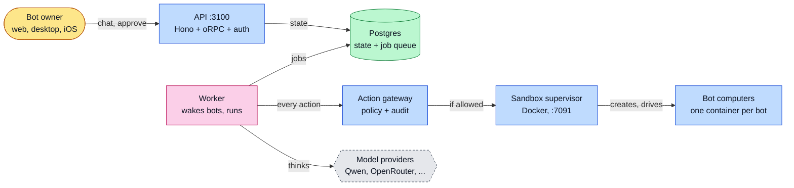
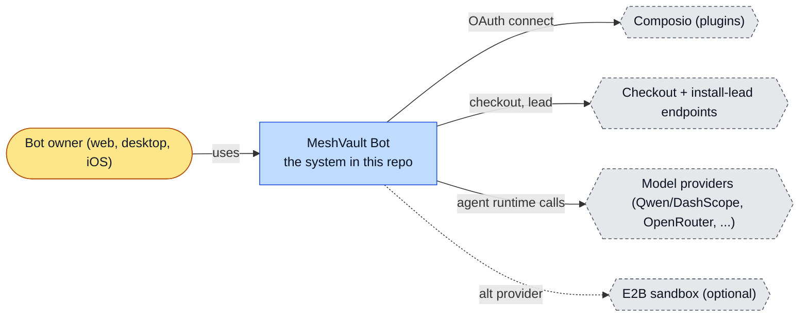
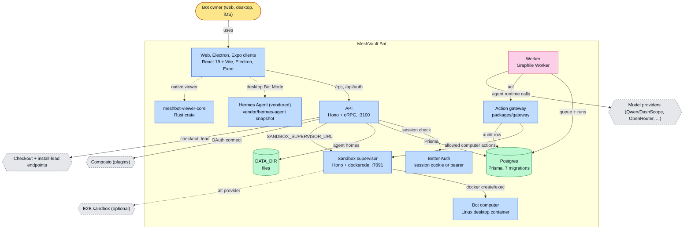
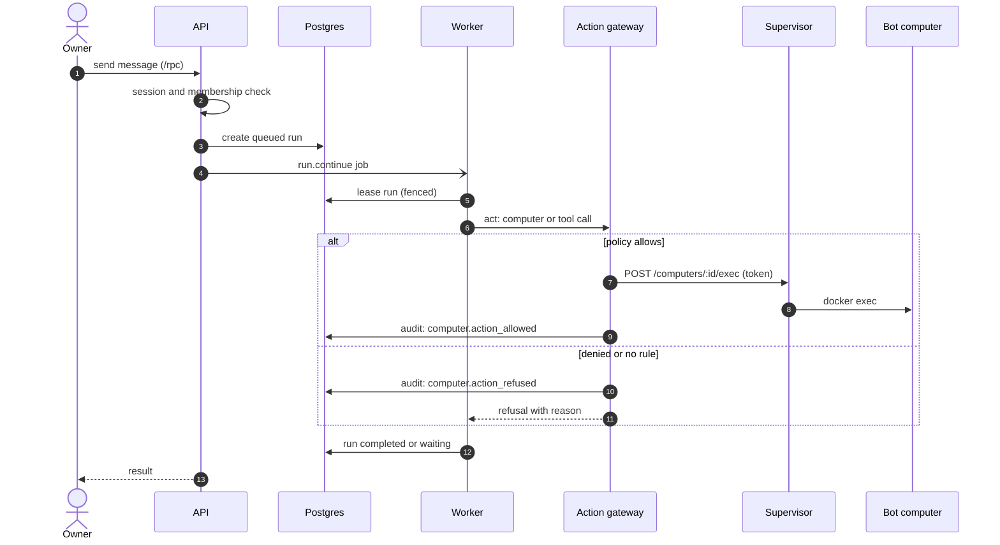
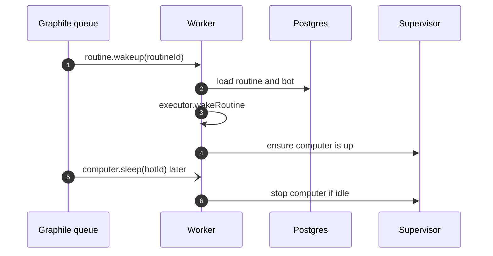
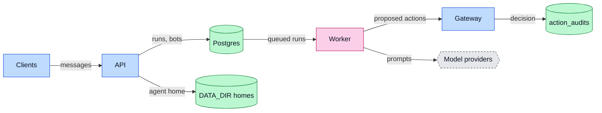
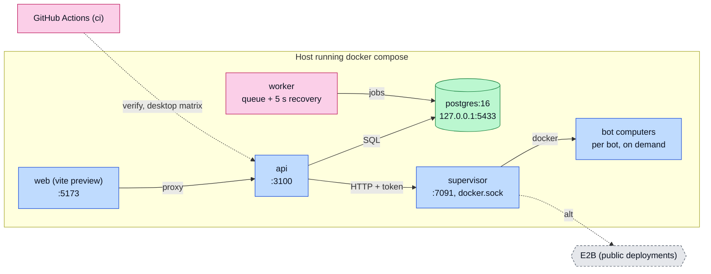
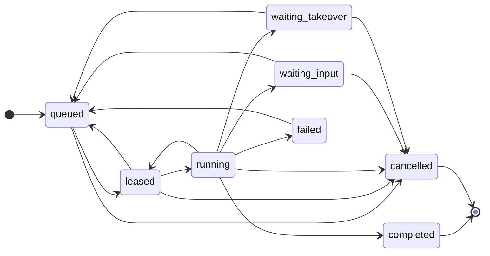

# MeshVault Bot: architecture

<!-- arch-kit:generated -->

> Whiteboard-level structure: what systems exist, what they talk to, and when they run. Evidence-backed; every box below maps to a path listed in [Evidence](#10-evidence).
> Generated by the ArchDocs kit from repo commit `da5823b27f`. Diagram sources: [`architecture/*.mmd`](architecture/). Hi-res renders sit next to each source.

## 1. Purpose

MeshVault Bot is a self-hostable bot application, a fork of elie222/rakazo. Each bot has one conversation thread, memory, routines and its own computer, which is a Docker container by default. A Hono API with oRPC and Better Auth serves web, Electron desktop and Expo iOS clients. A Graphile Worker process wakes bots for routines and queued runs. A sandbox supervisor creates and drives the per-bot computers through the Docker socket. An action gateway checks a fail-closed policy and writes an audit row before a bot acts. The agent runtime is Hermes Agent by default in the README; the shipped compose file sets `AGENT_RUNTIME: pi` for the API and worker.

## 2. Whiteboard view

Eight boxes. Nothing a bot does to its computer skips the gateway, and the gateway writes an audit row either way.

Hi-res: [SVG](architecture/whiteboard.svg) · [PNG 3x](architecture/whiteboard@3x.png) · [dark SVG](architecture/whiteboard.dark.svg) · [dark PNG 3x](architecture/whiteboard.dark@3x.png)

Explorable version (Archify, standalone HTML, download and open locally): [`architecture/meshvault-bot.archify.html`](architecture/meshvault-bot.archify.html)

## 3. System context (C4 level 1)

Who and what touches the system from outside.

Hi-res: [SVG](architecture/context.svg) · [PNG 3x](architecture/context@3x.png)

## 4. Containers and components (C4 level 2)

The parts that run or hold data inside the repo's system boundary.

Hi-res: [SVG](architecture/containers.svg) · [PNG 3x](architecture/containers@3x.png)

| Container | Kind | Tech | What it does | Evidence |
|---|---|---|---|---|
| Web, Electron, Expo clients | app | React 19 + Vite, Electron, Expo | Three clients of the same API. The web app proxies to the API on :5173. | [`README.md#L93`](../README.md#L93), [`infra/compose/docker-compose.yml#L87-L98`](../infra/compose/docker-compose.yml#L87-L98) |
| API | app | Hono + oRPC, :3100 | Auth routes, /rpc behind a session and membership check, /health, checkout and install-lead endpoints. | [`apps/api/src/app.ts#L150-L193`](../apps/api/src/app.ts#L150-L193), [`infra/compose/docker-compose.yml#L45-L65`](../infra/compose/docker-compose.yml#L45-L65) |
| Better Auth | app | session cookie or bearer | Sign-in, signup allowlist, blocked auth paths. Bearer tokens are mapped to the session cookie. | [`apps/api/src/app.ts#L55-L60`](../apps/api/src/app.ts#L55-L60), [`apps/api/src/app.ts#L174-L180`](../apps/api/src/app.ts#L174-L180), [`apps/api/src/app.ts#L239-L243`](../apps/api/src/app.ts#L239-L243) |
| Worker | job | Graphile Worker | Handles run.continue, routine.wakeup and computer.sleep; recovers queued runs every 5 s. | [`apps/worker/src/index.ts#L68-L104`](../apps/worker/src/index.ts#L68-L104) |
| Action gateway | app | packages/gateway | Fail-closed policy (deny before allow, empty policy permits nothing); writes an audit event for allowed, refused and failed actions. | [`packages/gateway/src/policy.ts#L1-L5`](../packages/gateway/src/policy.ts#L1-L5), [`packages/gateway/src/gateway.ts#L68-L71`](../packages/gateway/src/gateway.ts#L68-L71), [`packages/gateway/src/gateway.ts#L131-L151`](../packages/gateway/src/gateway.ts#L131-L151) |
| Sandbox supervisor | app | Hono + dockerode, :7091 | Token-protected /computers API: create, inspect, exec, screen, input, stop, delete. Talks to the Docker socket. | [`infra/sandboxes/supervisor/src/index.ts#L36-L51`](../infra/sandboxes/supervisor/src/index.ts#L36-L51), [`infra/sandboxes/supervisor/src/index.ts#L134-L135`](../infra/sandboxes/supervisor/src/index.ts#L134-L135), [`infra/sandboxes/supervisor/src/index.ts#L274-L276`](../infra/sandboxes/supervisor/src/index.ts#L274-L276) |
| Bot computer | app | Linux desktop container | One per bot: fluxbox desktop with a browser, started by the supervisor. | [`infra/sandboxes/computer/Dockerfile`](../infra/sandboxes/computer/Dockerfile), [`infra/sandboxes/computer/start.sh`](../infra/sandboxes/computer/start.sh) |
| Postgres | store | Prisma, 7 migrations | Users, bots, runs, routines, approvals and action_audits. Also the Graphile job queue. | [`packages/db/prisma/schema.prisma`](../packages/db/prisma/schema.prisma), [`packages/db/prisma/migrations/0007_action_audit/migration.sql`](../packages/db/prisma/migrations/0007_action_audit/migration.sql), [`infra/compose/docker-compose.yml#L2-L16`](../infra/compose/docker-compose.yml#L2-L16) |
| DATA_DIR | store | files | Agent homes and local data, mounted into api, worker and supervisor. | [`apps/api/src/app.ts#L86`](../apps/api/src/app.ts#L86), [`infra/compose/docker-compose.yml#L61-L62`](../infra/compose/docker-compose.yml#L61-L62) |
| meshbot-viewer-core | app | Rust crate | Native viewer client code (address, pairing, tls, client). | [`native/meshbot-viewer-core/src/lib.rs`](../native/meshbot-viewer-core/src/lib.rs), [`native/meshbot-viewer-core/Cargo.toml`](../native/meshbot-viewer-core/Cargo.toml) |
| Hermes Agent (vendored) | app | vendor/hermes-agent snapshot | Sparse snapshot of Nous Research code, mainly the Bot Mode plugin used by the desktop app. | [`README.md#L12`](../README.md#L12), [`README.md#L122-L133`](../README.md#L122-L133) |

## 5. Key runtime sequences

### 5.1 A message becomes a bot action on its computer

Run state, wakeups and the gateway are the safety spine. A refused action is audited and never reaches the supervisor.

Hi-res: [SVG](architecture/sequence-1.svg) · [PNG 3x](architecture/sequence-1@3x.png)

### 5.2 A routine wakes a bot

Hi-res: [SVG](architecture/sequence-2.svg) · [PNG 3x](architecture/sequence-2@3x.png)

## 6. Data flow and stores

Postgres is the source of truth for run state; files hold per-bot homes; every action decision is written back as an audit row.

Hi-res: [SVG](architecture/dataflow.svg) · [PNG 3x](architecture/dataflow@3x.png)

| Store | What it holds | Written by | Evidence |
|---|---|---|---|
| Postgres (Prisma) | Accounts, bots, runs and leases, routines, owner approvals, action_audits. Seven checked-in migrations. | API, worker, gateway | [`packages/db/prisma/schema.prisma`](../packages/db/prisma/schema.prisma), [`packages/db/prisma/migrations/0007_action_audit/migration.sql`](../packages/db/prisma/migrations/0007_action_audit/migration.sql) |
| Graphile job tables | run.continue, routine.wakeup, computer.sleep jobs (WAKEUP_DRIVER=graphile). | API and worker | [`apps/worker/src/index.ts#L68-L97`](../apps/worker/src/index.ts#L68-L97) |
| DATA_DIR | Per-bot agent homes and local state. | API, worker, supervisor | [`apps/api/src/app.ts#L86`](../apps/api/src/app.ts#L86), [`infra/compose/docker-compose.yml#L61-L62`](../infra/compose/docker-compose.yml#L61-L62) |
| Desktop bot-mode.json | Electron bot roster, mode 0600, in the desktop user-data directory. | Electron app | [`README.md#L133`](../README.md#L133) |

## 7. Deployment and runtime topology

docker compose runs five services; `pnpm dev` runs the same pieces on the host. The supervisor mounts the Docker socket, so its port must stay private.

Hi-res: [SVG](architecture/deployment.svg) · [PNG 3x](architecture/deployment@3x.png)

| What | Where | Runs when | Trigger / port | Evidence |
|---|---|---|---|---|
| Queued-run recovery | worker | Every 5 s | setInterval QUEUED_RUN_RECOVERY_MS | [`apps/worker/src/index.ts#L42`](../apps/worker/src/index.ts#L42), [`apps/worker/src/index.ts#L100-L104`](../apps/worker/src/index.ts#L100-L104) |
| Routine wakeups | worker via Graphile | Per routine schedule | routine.wakeup job | [`apps/worker/src/index.ts#L91-L93`](../apps/worker/src/index.ts#L91-L93) |
| Computer sleep | worker | When a bot's computer is idle | computer.sleep job | [`apps/worker/src/index.ts#L94-L96`](../apps/worker/src/index.ts#L94-L96) |
| CI + desktop build matrix | GitHub Actions (Ubuntu, macOS, Windows) | Every push and pull request | .github/workflows | [`README.md#L143`](../README.md#L143) |

## 8. Failure modes and how to see them

| Failure | What the user sees | How to see it | Evidence |
|---|---|---|---|
| No rule permits an action | Action refused and audited; the bot gets a reason | action_audits row `computer.action_refused` | [`packages/gateway/src/policy.ts#L91-L100`](../packages/gateway/src/policy.ts#L91-L100), [`packages/gateway/src/gateway.ts#L131-L134`](../packages/gateway/src/gateway.ts#L131-L134) |
| Policy JSON is malformed | Startup error naming MESHBOT_ACTION_POLICY | Error message at boot | [`packages/gateway/src/policy.ts#L124-L136`](../packages/gateway/src/policy.ts#L124-L136) |
| Worker dies mid-run | Lease expires; queued runs are re-enqueued every 5 s | Run stuck in leased/running until lease expiry | [`packages/core/src/run-state.ts#L39-L47`](../packages/core/src/run-state.ts#L39-L47), [`apps/worker/src/index.ts#L100-L104`](../apps/worker/src/index.ts#L100-L104) |
| Supervisor token wrong or missing | /computers calls rejected | HTTP error from the supervisor | [`infra/sandboxes/supervisor/src/index.ts#L38-L45`](../infra/sandboxes/supervisor/src/index.ts#L38-L45) |
| Compose runtime differs from README default | api and worker run `AGENT_RUNTIME: pi`, not hermes | `curl :3100/health` shows the runtime | [`infra/compose/docker-compose.yml#L58`](../infra/compose/docker-compose.yml#L58), [`README.md#L87-L89`](../README.md#L87-L89) |

## 9. State machine

Run status, from `allowed` in packages/core/src/run-state.ts. Illegal transitions throw.

Hi-res: [SVG](architecture/state.svg) · [PNG 3x](architecture/state@3x.png)

## 10. Evidence

Every path below exists at the pinned commit; links are relative to `docs/`.

| Path | Why it matters |
|---|---|
| [`apps/api/src/app.ts#L150-L193`](../apps/api/src/app.ts#L150-L193) | API: CORS, checkout, Composio callback, auth, /rpc session gate, /health. |
| [`apps/worker/src/index.ts#L68-L104`](../apps/worker/src/index.ts#L68-L104) | Worker: Graphile handlers and queued-run recovery. |
| [`packages/gateway/src/policy.ts`](../packages/gateway/src/policy.ts) | Fail-closed policy engine. |
| [`packages/gateway/src/gateway.ts#L68-L151`](../packages/gateway/src/gateway.ts#L68-L151) | Gateway act() and audit events. |
| [`packages/core/src/run-state.ts`](../packages/core/src/run-state.ts) | Run state machine and lease rules. |
| [`infra/sandboxes/supervisor/src/index.ts`](../infra/sandboxes/supervisor/src/index.ts) | Sandbox supervisor HTTP API over the Docker socket. |
| [`infra/compose/docker-compose.yml`](../infra/compose/docker-compose.yml) | Five-service compose topology and ports. |
| [`packages/db/prisma/schema.prisma`](../packages/db/prisma/schema.prisma) | Data model. |
| [`README.md`](../README.md) | Fork scope, providers, run modes, desktop and iOS release paths. |

Collected mechanically by the kit ([`architecture/facts.json`](architecture/facts.json), not hand-edited):

- entry points: `start`, `dev`, `test`, `@meshbot/desktop`, `dev`, `build`
- CI: `.github/workflows/ci.yml`
- external hosts seen in source: `github.com`, `meshvault.ai`, `api.stripe.com`, `api.resend.com`, `api.github.com`, `biomejs.dev`

Graphify (local AST, no LLM) read this repo: 3806 nodes, 7153 edges, 218 communities. Most connected: `AdapterContext` (138), `scripts` (65), `ComputerRef` (63), `ViewerError` (50), `SandboxProvider` (32).

- Report: [`architecture/graphify/GRAPH_REPORT.md`](architecture/graphify/GRAPH_REPORT.md)
